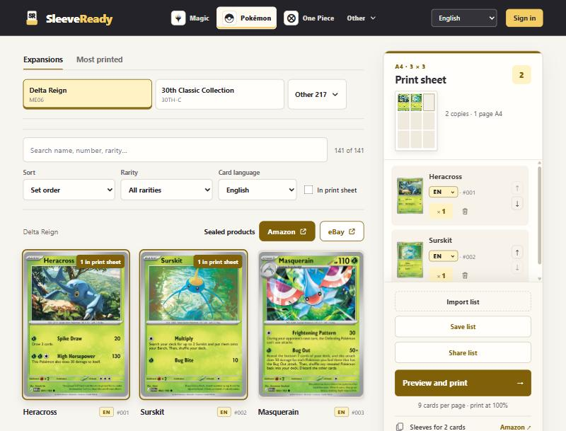
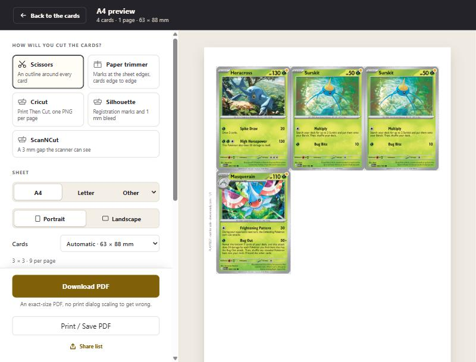
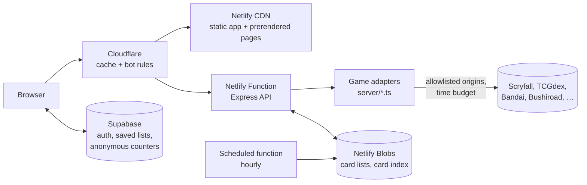

# SleeveReady

**Print playtest proxies for 15 trading card games.** Pick cards from any set, or paste a decklist, and download an exact-size PDF with nine 63 × 88 mm cards per A4 or US Letter page, ready to cut and sleeve.

**Live:** [sleeveready.com](https://sleeveready.com) · English, Italian, German, French, Spanish, Portuguese, Dutch and Polish

| Pick cards | Print preview |
|---|---|
|  |  |

## What it does

- **Catalog of 15 games** (Magic, Pokémon, One Piece, Lorcana, Yu-Gi-Oh!, Star Wars Unlimited, Flesh and Blood, Digimon, Dragon Ball Super, Gundam, Union Arena, Vanguard, Sorcery, Cyberpunk, Palworld). Each set is read from the game's own source, in every language the cards are actually printed in.
- **Decklist import** from Moxfield, Archidekt, MTG Arena, Pokémon TCG Live, Limitless, YDK and plain text. The server resolves set codes, printed ids and names, then swaps each card for the same printing in the chosen language.
- **Print layout** for scissors, paper trimmers, Cricut, Silhouette and ScanNCut. It handles bleed, gaps, duplex backs and landscape cards, and exports a PDF at exact size so no printer dialog scaling gets in the way.
- **Release board** of upcoming sets, with cards printable as soon as they are revealed.
- **Accounts** (Google or magic link) to save lists. Shared lists get a generated link-preview image.
- **Static pages** for every game, set, card and illustrator, so the catalog is reachable from search without JavaScript.

## Stack

| Layer | Choice |
|---|---|
| Frontend | React 19, TypeScript, Vite |
| API | Express 5, run as one Netlify Function (`serverless-http`) |
| Data | Upstream catalogs (Scryfall, TCGdex, Bandai, Bushiroad, LorcanaJSON, YGOPRODeck…), cached in memory and in Netlify Blobs |
| Accounts and stats | Supabase: Postgres with row-level security, Auth, and RPC functions |
| Edge | Cloudflare (cache and bot rules) in front of Netlify |
| Rendering | jsPDF for the print PDF; resvg (WASM) for share images |
| Tests | `node:test` via tsx (unit and HTTP), Playwright (browser flows) |

## Architecture



- **`server/`** has one adapter per game (`scryfall.ts`, `tcgdex.ts`, `onepiece.ts`, …). Each implements `NativeCatalog` (`sets`, `cards`, `languages`) on top of `SourceClient` in [`server/native-source.ts`](server/native-source.ts), which enforces an origin allowlist, no redirects, retries with backoff and a shared time budget.
- **`server/app.ts`** holds the API routes: zod-validated input, per-IP rate limits, CSP/HSTS headers, a host allowlist, and CDN cache headers on successful GETs only.
- **`scripts/`** runs at build time: it prerenders game, set and card pages and the sitemaps. A small Netlify build plugin carries card pages from one build to the next.
- **`netlify/functions/refresh-index.mts`** runs hourly. It indexes new and stale sets for name search and sitemaps within a fixed budget, behind a lock.
- **`supabase/migrations/`** holds the schema. Every table has row-level security, and anonymous writes go through definer functions that validate input and are throttled per caller.

## Key decisions and trade-offs

- **Native sources instead of one marketplace API.** The first version read everything from one marketplace API. Moving to each game's own source gave better images, real print languages and no API key, at the cost of 15 adapters to maintain. When a source changes its markup, only that game breaks, and tests pin each parser.
- **Prerendered pages, live API.** The app is a SPA, but search engines see static HTML for games, sets and cards. Googlebot cut its crawling when uncached pages took about 2 s, so set data now lives in Blobs for 30 days for older sets, and only the six newest sets are read live.
- **Fewer pages, on purpose.** After Google cut impressions by over 90% in November 2026, the card pages of 11 less-searched games were set to `noindex`: about 20,000 near-identical pages that drew about 1% of impressions. Their game and set pages stay indexed.
- **Cloudflare in front of Netlify.** Netlify bills function time and requests, and most traffic is bots. Cloudflare caches pages and applies bot rules. The `netlify.app` address only redirects, so crawlers cannot bypass the edge, and every deploy purges the Cloudflare cache.
- **A time budget for upstream calls.** A synchronous Netlify function stops after 10 s. Each upstream call, retries included, gets at most 9 s ([`server/upstream.ts`](server/upstream.ts)), so a slow source returns the app's own error instead of a platform timeout billed in full.
- **In-memory rate limits.** Limits are counted per function instance ([`server/rate-limit.ts`](server/rate-limit.ts)). They cost nothing and stop one client hammering a warm instance, but they reset on cold starts and are not shared. Cloudflare covers distributed abuse; a shared store would be the next step.
- **Printing without a canvas.** Cards are placed as native image elements and the PDF is built in the browser, so the server never downloads arbitrary images. The only image proxies (One Piece, Cyberpunk signed URLs, Gundam) accept validated ids and fetch from one fixed origin.
- **No third-party analytics.** Visits and prints are counted by Supabase RPC functions that store no user, device or address. No cookies, so no consent banner.
- **Image fallback for new Pokémon sets.** TCGdex lists new sets before it has scans, so those sets borrow images from the Pokémon TCG API, matched by set name and card number, until TCGdex catches up.

## Why and how I built it

I play trading card games. At my local game store people often print proxies to try a deck before they buy the cards, and SleeveReady is the tool I wanted for that.

I designed, built and run it on my own. AI coding agents were my engineering team: OpenAI Codex for the first prototype in September 2026, then Claude Code. Every product, architecture and launch decision was mine. The agents turned those decisions into code, and I checked the result.

**Architecture first**

The initial architecture mattered most to me, so I set it before adding features. There is one Express API that runs the same way locally and as a Netlify Function. Each game has its own adapter behind a single interface, and every outside call goes through one guarded client with allowed origins, retries and a time budget. Credentials stay on the server. Pages are static so search engines can read the catalog.

Because of that, adding a game means writing one adapter. When I replaced the marketplace API with each game's own source, the frontend didn't need a single change.

**Product decisions**

I chose a worldwide audience with the US as the main market. The site defaults to US Letter or A4 depending on the country, works in eight languages, and prints cards in the languages they actually exist in.

The home page is a release board of upcoming sets. Players of newer games come for spoilers, so revealed cards are printable the day they appear.

A PDF alone isn't enough to print proxies well, so I added layouts for scissors, paper trimmers, Cricut, Silhouette and ScanNCut. That's how people actually cut them.

I also said no to a few things. There's no third-party analytics and no cookie banner; I built my own anonymous counters instead. I stopped work on push notifications. I took Riftbound off the site until Riot grants an API key, since Riot only allows its cards through its API.

I renamed the project from ProxyTCG to SleeveReady when I found out proxytcg.com was an unrelated shop.

**Running it as a business**

To keep costs down I put Cloudflare in front of Netlify, so bots don't burn function credits, and cached card data in Netlify Blobs. Each deploy costs credits, so nothing gets deployed without my go-ahead.

I've started thinking about how to make money from it, but it's too early for that. For now, the shop links (Amazon, eBay, TCGplayer) just follow the page's language and country.

When Google cut search impressions by 90%, I read the data before touching anything. About 20,000 card pages across 11 games brought in 1% of impressions, so I took them out of the index instead of adding more pages. Impressions are now coming back up.

**How I used AI**

I didn't hand the agents code. I gave them goals and constraints and chose between the options they came back with. A change had to pass TypeScript, the tests and a check in a real browser before I approved it. I also used the agents as analysts: they read Search Console data, and before I published the repository they audited it for security, cost and code quality.

**What went wrong, and what I changed**
- Slow first responses (~4 s) made Google crawl less. I moved card data into caches and got pages under 0.5 s. Crawling is still recovering.
- A Cloudflare bot rule blocked Googlebot for two days. Now every edge rule goes through Search Console's live test before it goes live.
- The agents' code worked but was hard to read. I had it reformatted in a style I can review, and had the 3,600-line entry file split up.
- A card source changed overnight and broke one game. Now every adapter has parser tests and every outside call has a time budget.

## Running locally

Requires Node.js 22.19 or later.

```bash
npm install
cp .env.example .env.local   # every variable is optional for local use
npm run dev                  # http://127.0.0.1:3000
```

No catalog needs credentials. Accounts and saved lists need a Supabase project (`VITE_SUPABASE_URL`, `VITE_SUPABASE_PUBLISHABLE_KEY`); without one, the site works with lists stored in the browser.

| Command | What it runs |
|---|---|
| `npm test` | Unit and HTTP tests (`tests/*.test.ts`) |
| `npm run typecheck` | `tsc --noEmit` |
| `npm run lint` | ESLint |
| `npm run test:ui` | Playwright browser flows against the local server |
| `npm run build` | Typecheck, Vite build, prerendered pages |
| `npm run refresh:sets` | Refreshes release dates in `server/data/releases.json` |

Deployment (Netlify, Supabase, Cloudflare) is described in [DEPLOYMENT.md](DEPLOYMENT.md).

## Project layout

```
src/          React app: main.tsx boots it; app/ holds the App component and its helpers,
              hooks/ the reusable hooks, components/ the UI pieces, lib/ copy, print layout and PDF
server/       Express API and one adapter per game
shared/       Code used by both: models, SEO pages, decklist parsing, share links
scripts/      Build-time page generation and data refreshes
netlify/      Function entry points, scheduled jobs, build plugin
supabase/     SQL migrations
tests/        node:test suites and Playwright scripts
```

## Legal

Card images and names belong to their publishers. SleeveReady makes proxies for personal playtesting only and is not affiliated with any publisher. Some shop links are affiliate links, as stated in the site's terms.
